This file to keep track of experiment and results for the TT-Flow project
___
## Overview: Experiment # 1 – # 3 (RecFlow with a regression NN for $v_t$)

Common setup for all three experiments:
* $v_t$ approximator: `VelocityFieldRegressionNet` (simple MLP regression net), hidden dim 128, depth 2, global trajectory model, Adam optimizer
* Data split: train / test / eval = 500,000 / 200,000 / 200,000 samples
  * **train**: used to train the model
  * **test**: used to evaluate the model during training epochs
  * **eval**: used for inference (final evaluation of generated samples)
* 1-RecFlow = rectified flow with 0 reflows, 2-RecFlow = 1 reflow
* ODE solvers compared: `euler`, `rk4`, `dopri8`, all with 1000 time points
* Inference: 200,000 samples are generated per run, the same size as the 200,000-sample eval pool. Reported inference times are for generating all 200K samples.
* Evaluation protocol (`TransportEvaluator.evaluate_sinkhorn_by_blur` in `ttflow/inference/inference_and_evaluation.py`):
  * Metric: debiased Sinkhorn divergence (`geomloss.SamplesLoss`, `p=2`), lower is better.
  * Sinkhorn is **not** computed on the full 200K pools. For each blur value, the evaluator runs **5 repeats**. Each repeat draws random subsets of **10,000** samples: two independent subsets from the real eval pool ($X_1, X_2$) and two from the generated pool ($Y_1, Y_2$).
  * Each repeat computes three values:
    * **generated–real**: $S(X_1, Y_1)$
    * **real–real**: $S(X_1, X_2)$, the sampling-noise floor that a perfect generator would reach
    * **generated–generated**: $S(Y_1, Y_2)$
  * The tables report the mean ± std (n−1) of each value over the 5 repeats.
  * Blur grid: 10 fixed values (0.01, 0.02, 0.05, 0.1, 0.2, 0.5, 1, 2, 5, 10) plus 5 data-scale-aware values. These are 0.1×, 0.25×, 0.5×, 1× and 2× the median nearest-neighbour distance of 5,000 real samples, so the blur grid differs slightly between datasets.
* **Sinkhorn Δ** $= S(\text{generated}, \text{real}) - S(\text{real}, \text{real})$: the generated–real Sinkhorn divergence minus the real–real floor (lower is better, 0 is perfect).

### Inference time (s)

| Dataset | Solver | 1-RecFlow | 2-RecFlow |
|---|---|---|---|
| Experiment # 1: Skewed Gaussian 2D | `euler` | 113.27 | 117.14 |
| Experiment # 1: Skewed Gaussian 2D | `rk4` | 453.40 | 469.95 |
| Experiment # 1: Skewed Gaussian 2D | `dopri8` | 611.76 | 222.43 |
| Experiment # 2: Many-well, total dim 8, many-well dim 4 | `euler` | 5.02 | 8.33 |
| Experiment # 2: Many-well, total dim 8, many-well dim 4 | `rk4` | 29.10 | 35.51 / 26.80 |
| Experiment # 2: Many-well, total dim 8, many-well dim 4 | `dopri8` | 41.75 | 23.87 |
| Experiment # 3: Many-well, total dim 8, many-well dim 8 | `euler` | 6.77 | 13.34 |
| Experiment # 3: Many-well, total dim 8, many-well dim 8 | `rk4` | 24.88 | 36.17 |
| Experiment # 3: Many-well, total dim 8, many-well dim 8 | `dopri8` | 60.79 | 23.31 |

### Summary across datasets

Sinkhorn Δ = generated–real Sinkhorn minus real–real Sinkhorn, averaged over blur ≤ 0.2 and over the three solvers.

| Dataset | 1-RecFlow Sinkhorn Δ | 2-RecFlow Sinkhorn Δ | Change with reflow | Blurs where 2-RF is significantly worse | `dopri8` speed-up from reflow |
|---|---|---|---|---|---|
| Experiment # 1: Skewed Gaussian 2D | 0.0008–0.0009 | 0.0009–0.0010 | ≈ no change (+10%) | 2–3 / 15, scattered | 2.75× (611.8 → 222.4 s) |
| Experiment # 2: MW 8/4 | 0.076–0.085 | 0.101–0.107 | **+30%** | 6–8 / 15, mostly blur ≤ 0.2 | 1.75× (41.8 → 23.9 s) |
| Experiment # 3: MW 8/8 | 0.081–0.088 | 0.149–0.153 | **+80%** | 14–15 / 15, every scale | 2.6× (60.8 → 23.3 s) |

1. **The reflow consistently speeds up the adaptive solver only.** `dopri8` gets 1.75–2.75× faster after one reflow on every dataset, which indicates straighter learned trajectories. Fixed-step `euler` and `rk4` always make the same 1000-step evaluations, so their time differences are run-to-run noise.
2. **The quality cost of the reflow grows with dataset difficulty.** It is negligible on the 2D skewed Gaussian, +30% Sinkhorn Δ on Experiment # 2 (MW 8/4) and +80% on Experiment # 3 (MW 8/8). With this regression net, 2-RecFlow trades sample quality for straightness on the many-well data.
3. **The ODE solver does not affect quality.** Within each dataset and RecFlow level, the spread between solvers at the smallest blur is at most one std: 0.0002 vs 0.0002 on Experiment # 1, 0.008 vs 0.009 on Experiment # 2 and 0.008 vs 0.026 on Experiment # 3. `euler` is the cost-optimal choice: 4–9× cheaper on 1-RecFlow.
4. **Next checks for 2-RecFlow on many-well:**
   * Which solver and step count were used to generate the reflow couplings. Errors in the 1-RecFlow samples become the training target.
   * Whether hidden dim 128 is enough capacity to fit the reflowed field.
   * The inference figures, to check whether the 2-RecFlow samples drop modes or put mass between wells.
5. Many of the many-well inference runs (Experiment # 2 and # 3) exit with `SIGSEGV` (exit code 139) *after* finishing successfully, while the process shuts down. Results and figures are written before the crash.

___
### Experiment # 1
**Skewed Gaussian 2D, RecFlow with a regression NN**

* Target dataset $\pi_1$: skewed Gaussian 2D with mean $[0, 0]$, cov $I_2$, shape $[5, 5]$
* Model: `VelocityFieldRegressionNet`, hidden dim 128, depth 2, Adam
* Model artifacts: _TODO (links to be added)_
* Artifacts: `experiments_and_results/11/{1-Recflow,2-RecFlow}/{euler,rk4,dopri8}`
* Source of results: `experiments_and_results/11/desc.md`

#### Inference time (s), 200,000 samples

| Solver | 1-RecFlow time (s) | 2-RecFlow time (s) |
|---|---|---|
| `euler` | 113.27 | 117.14 |
| `rk4` | 453.40 | 469.95 |
| `dopri8` | 611.76 | 222.43 |

#### Sinkhorn divergence: real vs generated (mean ± std, lower is better)

RF = RecFlow. The real–real column is the floor.

| blur | real–real (floor) | 1-RF euler | 1-RF rk4 | 1-RF dopri8 | 2-RF euler | 2-RF rk4 | 2-RF dopri8 |
|---|---|---|---|---|---|---|---|
| 0.001878 | 0.0018 ± 0.0003 | 0.0027 ± 0.0002 | 0.0025 ± 0.0003 | 0.0025 ± 0.0001 | 0.0025 ± 0.0006 | 0.0029 ± 0.0006 | 0.0027 ± 0.0002 |
| 0.004696 | 0.0016 ± 0.0001 | 0.0025 ± 0.0006 | 0.0026 ± 0.0006 | 0.0025 ± 0.0005 | 0.0029 ± 0.0006 | 0.0030 ± 0.0007 | 0.0028 ± 0.0006 |
| 0.009392 | 0.0017 ± 0.0002 | 0.0025 ± 0.0003 | 0.0027 ± 0.0009 | 0.0028 ± 0.0005 | 0.0023 ± 0.0002 | 0.0027 ± 0.0006 | 0.0023 ± 0.0005 |
| 0.01 | 0.0018 ± 0.0003 | 0.0025 ± 0.0006 | 0.0026 ± 0.0004 | 0.0027 ± 0.0006 | 0.0027 ± 0.0006 | 0.0031 ± 0.0007 | 0.0028 ± 0.0003 |
| 0.01878 | 0.0016 ± 0.0002 | 0.0027 ± 0.0005 | 0.0028 ± 0.0008 | 0.0024 ± 0.0004 | 0.0024 ± 0.0010 | 0.0023 ± 0.0004 | 0.0027 ± 0.0006 |
| 0.02 | 0.0018 ± 0.0003 | 0.0023 ± 0.0002 | 0.0021 ± 0.0003 | 0.0023 ± 0.0002 | 0.0027 ± 0.0003 | 0.0028 ± 0.0006 | 0.0027 ± 0.0006 |
| 0.03757 | 0.0016 ± 0.0003 | 0.0026 ± 0.0005 | 0.0022 ± 0.0003 | 0.0027 ± 0.0006 | 0.0024 ± 0.0006 | 0.0024 ± 0.0004 | 0.0025 ± 0.0003 |
| 0.05 | 0.0013 ± 0.0002 | 0.0019 ± 0.0002 | 0.0020 ± 0.0002 | 0.0019 ± 0.0002 | 0.0024 ± 0.0003 | 0.0024 ± 0.0005 | 0.0023 ± 0.0004 |
| 0.1 | 0.0015 ± 0.0002 | 0.0023 ± 0.0004 | 0.0024 ± 0.0003 | 0.0025 ± 0.0008 | 0.0022 ± 0.0002 | 0.0023 ± 0.0005 | 0.0021 ± 0.0005 |
| 0.2 | 9.36e-04 ± 6.9e-05 | 0.0019 ± 0.0006 | 0.0022 ± 0.0003 | 0.0021 ± 0.0003 | 0.0016 ± 0.0002 | 0.0015 ± 0.0003 | 0.0014 ± 0.0003 |
| 0.5 | 6.74e-04 ± 1.3e-04 | 0.0011 ± 0.0005 | 0.0013 ± 0.0004 | 0.0011 ± 0.0003 | 0.0014 ± 0.0005 | 0.0013 ± 0.0003 | 0.0015 ± 0.0004 |
| 1 | 4.44e-04 ± 2.1e-04 | 9.05e-04 ± 2.3e-04 | 9.33e-04 ± 6.6e-04 | 0.0011 ± 0.0005 | 7.72e-04 ± 3.3e-04 | 0.0010 ± 0.0008 | 0.0012 ± 0.0009 |
| 2 | 2.12e-04 ± 9.5e-05 | 5.78e-04 ± 3.6e-04 | 6.66e-04 ± 1.7e-04 | 7.26e-04 ± 3.6e-04 | 7.42e-04 ± 2.8e-04 | 0.0013 ± 0.0010 | 9.65e-04 ± 5.1e-04 |
| 5 | 1.90e-04 ± 2.3e-04 | 2.88e-04 ± 1.9e-04 | 4.24e-04 ± 2.6e-04 | 3.73e-04 ± 1.7e-04 | 8.14e-04 ± 3.6e-04 | 0.0012 ± 0.0004 | 9.82e-04 ± 3.9e-04 |
| 10 | 3.15e-05 ± 1.3e-05 | 2.01e-04 ± 1.2e-04 | 3.35e-04 ± 2.3e-04 | 5.33e-04 ± 1.7e-04 | 7.54e-04 ± 6.0e-04 | 0.0010 ± 0.0005 | 6.57e-04 ± 4.3e-04 |

#### Analysis: 1-RecFlow vs 2-RecFlow
* **Both models are essentially at the noise floor.** At blur ≤ 0.2, all six runs score 0.0019–0.0031, against a real–real floor of 0.0009–0.0018. That is a Sinkhorn Δ of only about 0.001, so this 2D target is learned well by both models.
* **1-RecFlow and 2-RecFlow are indistinguishable at local scales.** 2-RF is significantly worse at only 2–3 of 15 blurs per solver, and those blurs are scattered (0.02, 0.05, 5, 10). For `rk4` and `dopri8`, 2-RF is even slightly better at blur 0.2. This pattern is noise, not a trend.
* **There is one consistent small regression at large blur.** At blur = 5, all three solvers are significantly worse after the reflow: 2.9–4.2e-4 becomes 8.1e-4–1.2e-3. Large blurs mostly measure global moments such as mean and spread, so this points to a slight global shift or scale error in the 2-RF samples. In absolute terms it is still about 1e-3.
* **Speed:** the reflow cuts `dopri8` time from 611.8 s to 222.4 s (2.75×), the largest speed-up of the three datasets. `euler` (113 → 117 s) and `rk4` (453 → 470 s) are unchanged, as expected for fixed-step solvers.
* **Takeaway:** on this dataset the reflow straightens trajectories at no meaningful quality cost. `euler` with 1-RecFlow is still cheapest overall (113 s), and `dopri8` with 2-RecFlow is the best adaptive option.

#### Figures

Click an image to open it at full size. Inference = base distribution, target and generated samples. Trajectories = $x_t$ per dimension over time. 2D trajectories = the same paths in the plane ($N = 100$).

##### 1-RecFlow

| Solver | Inference | Trajectories over time | 2D trajectories |
|---|---|---|---|
| `euler` |  | <a href="experiments_and_results/11/1-Recflow/euler/rectified_flow_trajectories.png">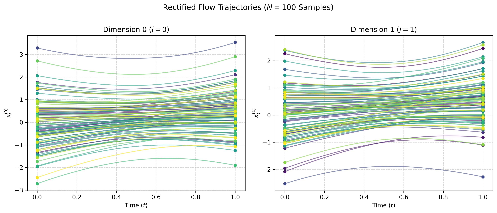</a> | <a href="experiments_and_results/11/1-Recflow/euler/rectified_flow_2d_space.png">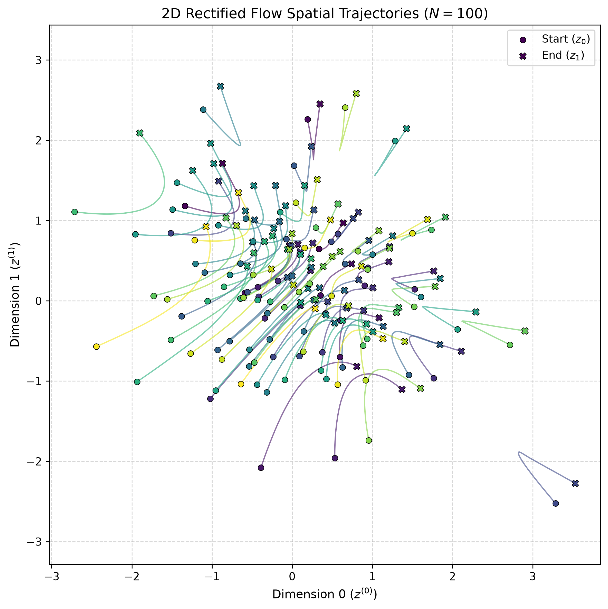</a> |
| `rk4` |  | <a href="experiments_and_results/11/1-Recflow/rk4/rectified_flow_trajectories.png">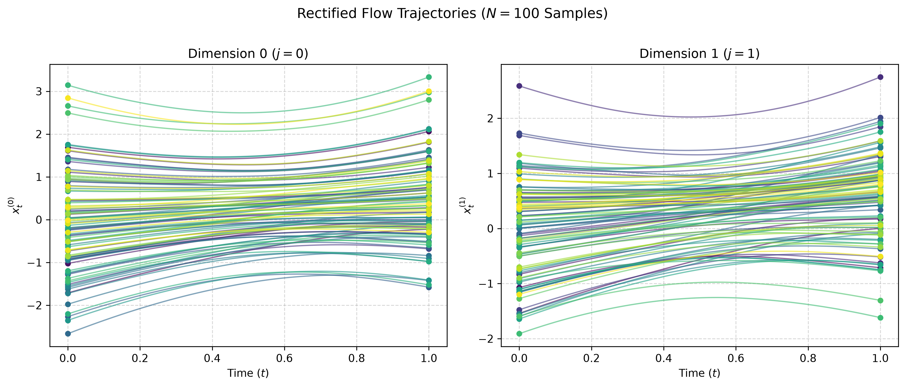</a> | <a href="experiments_and_results/11/1-Recflow/rk4/rectified_flow_2d_space.png">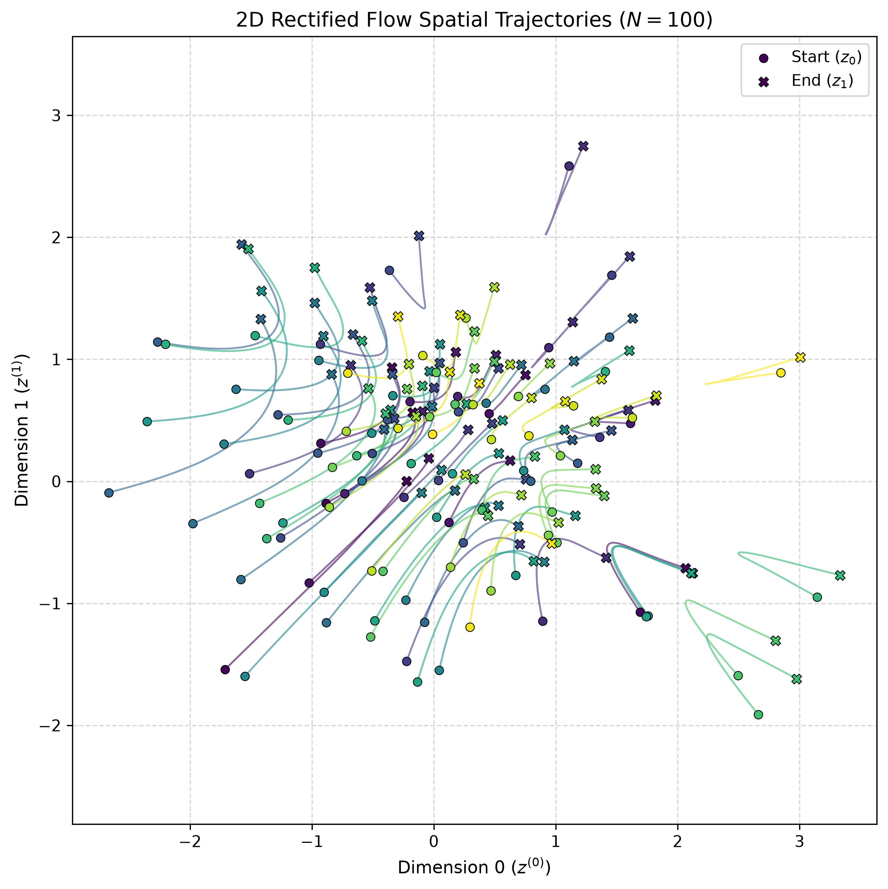</a> |
| `dopri8` |  | <a href="experiments_and_results/11/1-Recflow/dopri8/rectified_flow_trajectories.png">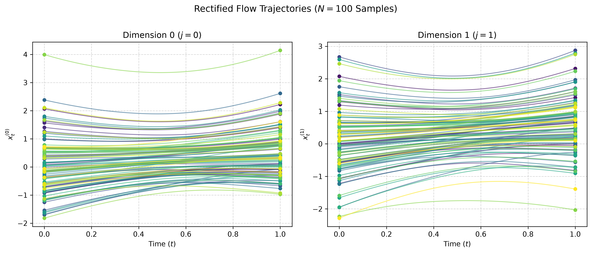</a> | <a href="experiments_and_results/11/1-Recflow/dopri8/rectified_flow_2d_space.png">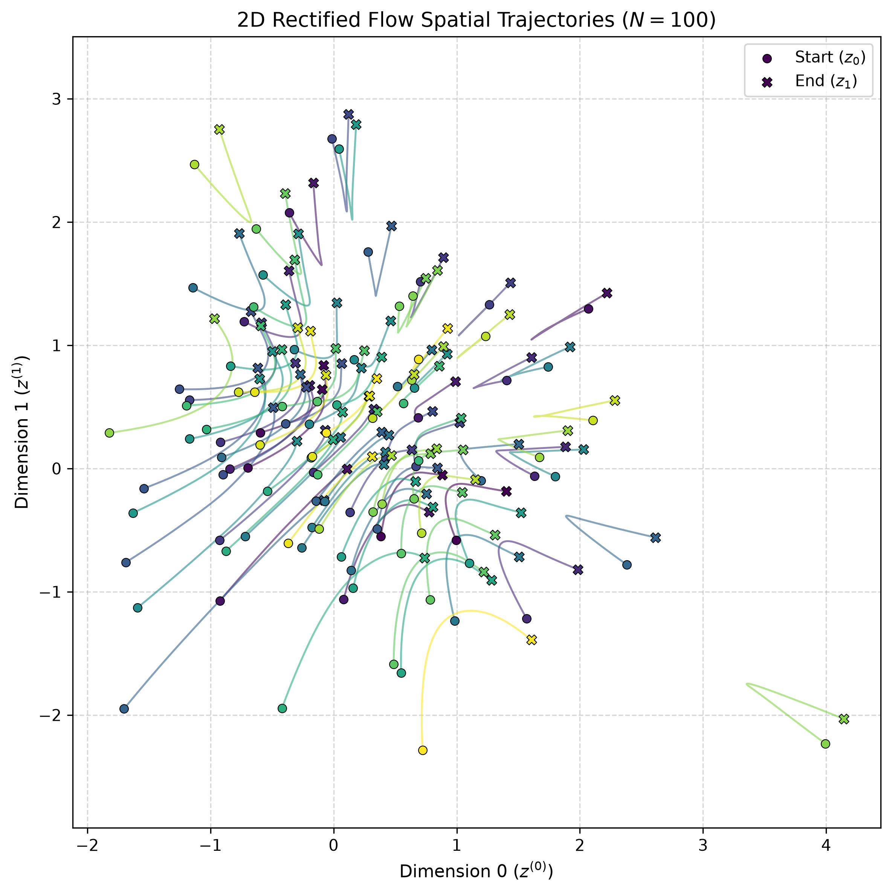</a> |

##### 2-RecFlow

| Solver | Inference | Trajectories over time | 2D trajectories |
|---|---|---|---|
| `euler` |  | <a href="experiments_and_results/11/2-RecFlow/euler/rectified_flow_trajectories.png">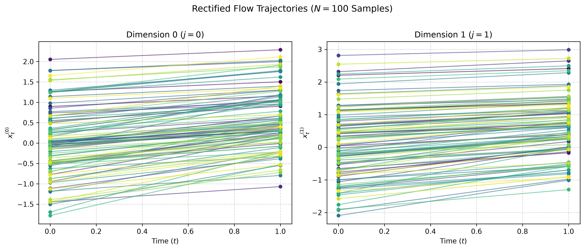</a> | <a href="experiments_and_results/11/2-RecFlow/euler/rectified_flow_2d_space.png">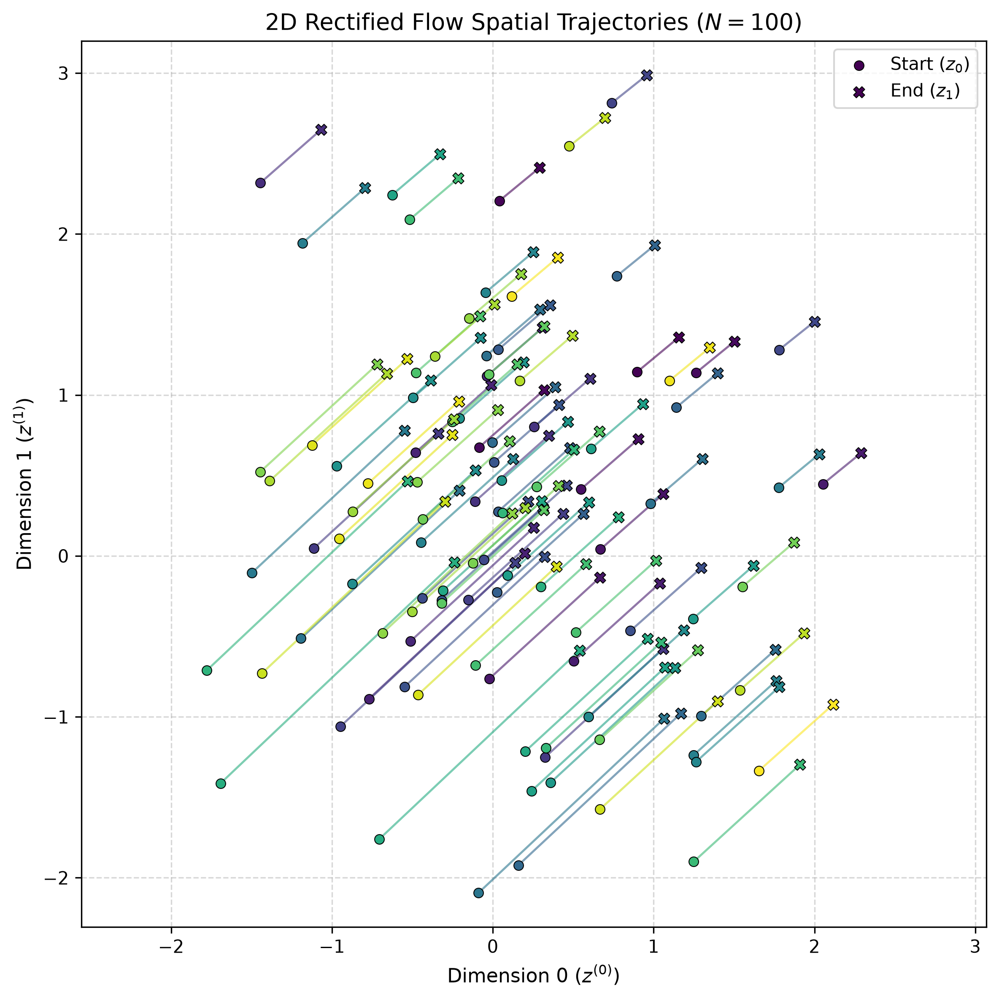</a> |
| `rk4` |  | <a href="experiments_and_results/11/2-RecFlow/rk4/rectified_flow_trajectories.png">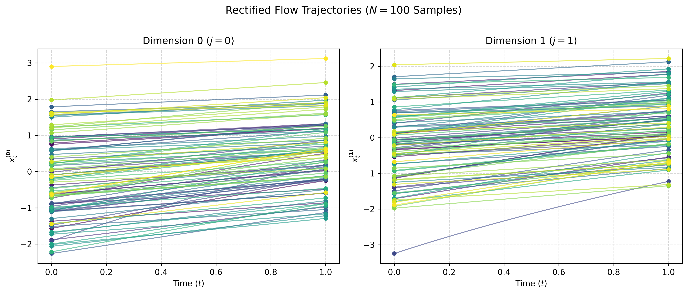</a> | <a href="experiments_and_results/11/2-RecFlow/rk4/rectified_flow_2d_space.png">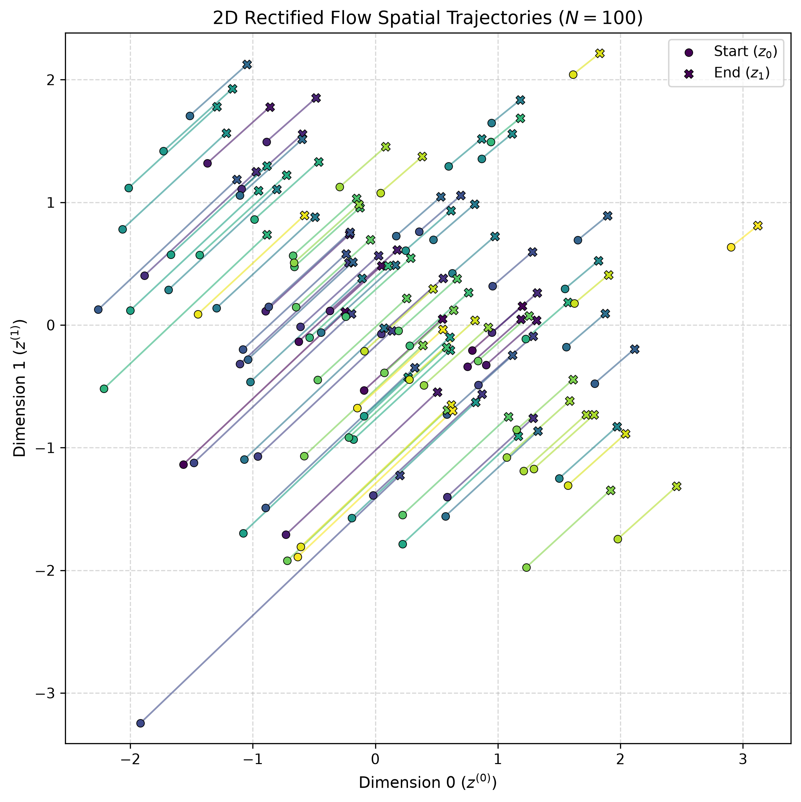</a> |
| `dopri8` |  | <a href="experiments_and_results/11/2-RecFlow/dopri8/rectified_flow_trajectories.png">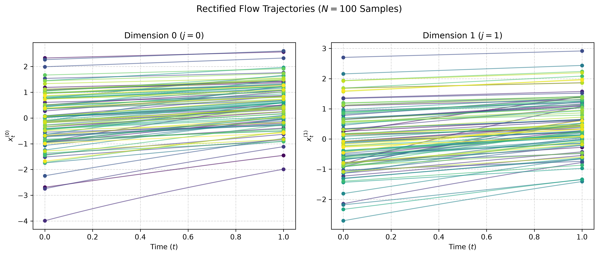</a> | <a href="experiments_and_results/11/2-RecFlow/dopri8/rectified_flow_2d_space.png">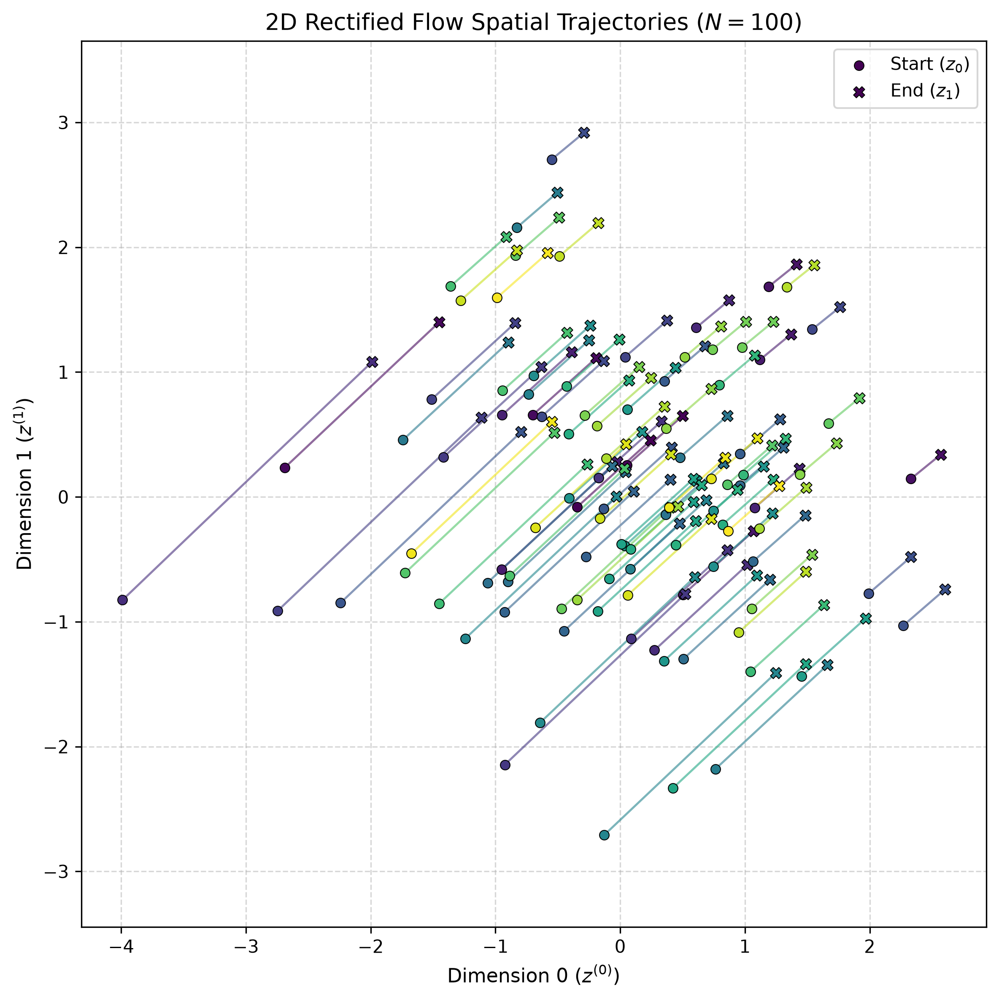</a> |

___
### Experiment # 2
**Many-well, total dim 8, many-well dim 4, RecFlow with a regression NN**

* Data: many-well with total data dim 8 and many-well dim 4
* Model: `VelocityFieldRegressionNet`, hidden dim 128, depth 2, Adam
* Model artifacts: _TODO (links to be added)_
* Artifacts: `experiments_and_results/12/{1-RecFlow,2-RecFlow}/{euler,rk4,dopri8}`
* Source of results: `experiments_and_results/12/desc.md`
* Note: `desc.md` contains two 2-RecFlow `rk4` runs (35.51 s and 26.80 s). Both are reported below as run 1 and run 2.

#### Inference time (s), 200,000 samples

| Solver | 1-RecFlow time (s) | 2-RecFlow time (s) |
|---|---|---|
| `euler` | 5.02 | 8.33 |
| `rk4` | 29.10 | 35.51 / 26.80 |
| `dopri8` | 41.75 | 23.87 |

#### Sinkhorn divergence: real vs generated (mean ± std, lower is better)

RF = RecFlow. The real–real column is the floor.

| blur | real–real (floor) | 1-RF euler | 1-RF rk4 | 1-RF dopri8 | 2-RF euler | 2-RF rk4 (run 1) | 2-RF rk4 (run 2) | 2-RF dopri8 |
|---|---|---|---|---|---|---|---|---|
| 0.01 | 0.4808 ± 0.0035 | 0.5716 ± 0.0102 | 0.5634 ± 0.0113 | 0.5710 ± 0.0065 | 0.5823 ± 0.0033 | 0.5861 ± 0.0069 | 0.5858 ± 0.0088 | 0.5790 ± 0.0026 |
| 0.02 | 0.4846 ± 0.0047 | 0.5686 ± 0.0116 | 0.5679 ± 0.0118 | 0.5717 ± 0.0178 | 0.5911 ± 0.0099 | 0.5855 ± 0.0085 | 0.5840 ± 0.0073 | 0.5816 ± 0.0044 |
| 0.05 | 0.4792 ± 0.0055 | 0.5526 ± 0.0175 | 0.5557 ± 0.0037 | 0.5666 ± 0.0181 | 0.5870 ± 0.0064 | 0.5874 ± 0.0060 | 0.5946 ± 0.0173 | 0.5864 ± 0.0090 |
| 0.08691 | 0.4853 ± 0.0098 | 0.5578 ± 0.0043 | 0.5596 ± 0.0130 | 0.5752 ± 0.0108 | 0.5863 ± 0.0047 | 0.5868 ± 0.0084 | 0.5956 ± 0.0127 | 0.5832 ± 0.0117 |
| 0.1 | 0.4868 ± 0.0125 | 0.5554 ± 0.0111 | 0.5562 ± 0.0200 | 0.5627 ± 0.0155 | 0.5850 ± 0.0110 | 0.5901 ± 0.0098 | 0.5912 ± 0.0077 | 0.5843 ± 0.0104 |
| 0.2 | 0.4633 ± 0.0059 | 0.5398 ± 0.0269 | 0.5326 ± 0.0137 | 0.5421 ± 0.0173 | 0.5655 ± 0.0078 | 0.5655 ± 0.0076 | 0.5686 ± 0.0057 | 0.5696 ± 0.0075 |
| 0.2173 | 0.4512 ± 0.0063 | 0.5447 ± 0.0241 | 0.5279 ± 0.0153 | 0.5338 ± 0.0113 | 0.5559 ± 0.0079 | 0.5539 ± 0.0063 | 0.5549 ± 0.0059 | 0.5540 ± 0.0088 |
| 0.4345 | 0.2808 ± 0.0070 | 0.3524 ± 0.0211 | 0.3616 ± 0.0182 | 0.3496 ± 0.0108 | 0.3697 ± 0.0042 | 0.3676 ± 0.0062 | 0.3732 ± 0.0060 | 0.3684 ± 0.0107 |
| 0.5 | 0.2373 ± 0.0104 | 0.2950 ± 0.0162 | 0.2994 ± 0.0104 | 0.2933 ± 0.0040 | 0.3114 ± 0.0102 | 0.3132 ± 0.0166 | 0.3165 ± 0.0082 | 0.3115 ± 0.0060 |
| 0.8691 | 0.0726 ± 0.0045 | 0.1020 ± 0.0053 | 0.1121 ± 0.0085 | 0.1095 ± 0.0030 | 0.1129 ± 0.0062 | 0.1130 ± 0.0022 | 0.1163 ± 0.0037 | 0.1083 ± 0.0077 |
| 1 | 0.0504 ± 0.0019 | 0.0811 ± 0.0075 | 0.0777 ± 0.0075 | 0.0787 ± 0.0059 | 0.0795 ± 0.0035 | 0.0808 ± 0.0044 | 0.0821 ± 0.0080 | 0.0793 ± 0.0039 |
| 1.738 | 0.0066 ± 0.0007 | 0.0188 ± 0.0015 | 0.0175 ± 0.0022 | 0.0188 ± 0.0034 | 0.0209 ± 0.0034 | 0.0212 ± 0.0020 | 0.0225 ± 0.0030 | 0.0211 ± 0.0020 |
| 2 | 0.0036 ± 0.0005 | 0.0157 ± 0.0024 | 0.0153 ± 0.0024 | 0.0144 ± 0.0024 | 0.0171 ± 0.0037 | 0.0162 ± 0.0011 | 0.0174 ± 0.0017 | 0.0164 ± 0.0036 |
| 5 | 0.0011 ± 0.0004 | 0.0102 ± 0.0024 | 0.0095 ± 0.0016 | 0.0103 ± 0.0015 | 0.0084 ± 0.0014 | 0.0085 ± 0.0013 | 0.0074 ± 0.0018 | 0.0090 ± 0.0012 |
| 10 | 9.08e-04 ± 5.7e-04 | 0.0088 ± 0.0017 | 0.0103 ± 0.0010 | 0.0094 ± 0.0024 | 0.0077 ± 0.0031 | 0.0073 ± 0.0026 | 0.0078 ± 0.0029 | 0.0068 ± 0.0020 |

#### Analysis: 1-RecFlow vs 2-RecFlow
* **1-RecFlow is already about 17–19% above the floor at local scales.** At blur 0.01 it scores 0.563–0.572 against a floor of 0.481. The average Sinkhorn Δ over blur ≤ 0.2 is 0.076–0.085.
* **2-RecFlow is clearly worse at local scales.** At blur 0.01 it scores 0.579–0.586, and the average Sinkhorn Δ grows to 0.101–0.107 (+30%). It is significantly worse at 6–8 of 15 blurs for every solver, concentrated at blur ≤ 0.2–0.5, the scale of the individual wells.
* **The global structure is not degraded.** At large blurs (≥ 5), 2-RF is equal to or slightly better than 1-RF. At blur 10 it scores 0.0068–0.0078, against 0.0088–0.0103 for 1-RF. The reflow keeps the global mean and spread but loses accuracy *inside and between wells*.
* **Generated samples look less like real data internally.** The generated–generated Sinkhorn exceeds the real–real floor by 0.017 on average for 1-RF and by 0.040 for 2-RF, 2.3× more. The 2-RF samples have a different within-sample structure than the data, for example more diffuse wells or an uneven split of mass across wells. Check this in the figures.
* **Speed:** `dopri8` goes from 41.8 s to 23.9 s (1.75×). `euler` (5.0 → 8.3 s) and `rk4` (29.1 → 26.8 / 35.5 s across two runs) show only timing noise.
* **Takeaway:** for MW 8/4, use 1-RecFlow with `euler` (5 s, best or tied-best quality). The reflow is not worth it with the current regression net.

#### Figures

Click an image to open it at full size. Inference = base distribution, target and generated samples. Trajectories = $x_t$ over time.

##### 1-RecFlow

| Solver | Inference | Trajectories |
|---|---|---|
| `euler` |  |  |
| `rk4` |  |  |
| `dopri8` |  |  |

> Note: the trajectory file in `1-RecFlow/dopri8/` is named `..._rk4_2026-11-09T16:45:30...`, the same as the `rk4` one. It is probably a copy of the `rk4` plot, not the `dopri8` trajectory.

##### 2-RecFlow

| Solver | Inference | Trajectories |
|---|---|---|
| `euler` |  |  |
| `rk4` (run 1, 35.51 s) |  | — |
| `rk4` (run 2, 26.80 s) |  |  |
| `dopri8` |  |  |

> Notes: the `rk4` trajectory plot has timestamp 2026-11-11T04:23:02, which matches neither `rk4` run. `2-RecFlow/rk4/` also holds an extra inference image from 2026-11-11T01:17:34 that is not in `desc.md`, and `2-RecFlow/euler/` holds three `rk4` inference images that seem misplaced. None of these are linked here.

___
### Experiment # 3
**Many-well, total dim 8, many-well dim 8, RecFlow with a regression NN**

* Data snapshot: `data-snapshots/experimental/data_snapshot_many_well_data_dim_8_many_well_dim_8_n_train_500000_n_test_200000_n_eval_200000_timestamp_2026-11-18T20:31:13.605688.pkl`
* Model: `VelocityFieldRegressionNet`, hidden dim 128, depth 2, Adam
* Model artifacts: _TODO (links to be added)_
* Artifacts: `experiments_and_results/13/{1-RecFlow,2-RecFlow}/{euler,rk4,dopri8}`
* Source of results:
  * 1-RecFlow: `experiments_and_results/13/desc.md`
  * 2-RecFlow: `logs/inference_2026-11-19T18-30-35.log`, produced by `scripts/run_inference.sh`

#### Inference time (s), 200,000 samples

| Solver | 1-RecFlow time (s) | 2-RecFlow time (s) |
|---|---|---|
| `euler` | 6.77 | 13.34 |
| `rk4` | 24.88 | 36.17 |
| `dopri8` | 60.79 | 23.31 |

#### Sinkhorn divergence: real vs generated (mean ± std, lower is better)

RF = RecFlow. The real–real column is the floor.

| blur | real–real (floor) | 1-RF euler | 1-RF rk4 | 1-RF dopri8 | 2-RF euler | 2-RF rk4 | 2-RF dopri8 |
|---|---|---|---|---|---|---|---|
| 0.01 | 0.3306 ± 0.0084 | 0.4241 ± 0.0217 | 0.4246 ± 0.0200 | 0.4319 ± 0.0347 | 0.4822 ± 0.0107 | 0.4826 ± 0.0113 | 0.4848 ± 0.0111 |
| 0.02 | 0.3443 ± 0.0137 | 0.4265 ± 0.0284 | 0.4260 ± 0.0267 | 0.4387 ± 0.0202 | 0.4914 ± 0.0088 | 0.4872 ± 0.0111 | 0.4810 ± 0.0035 |
| 0.05 | 0.3359 ± 0.0051 | 0.4246 ± 0.0291 | 0.4214 ± 0.0416 | 0.4325 ± 0.0227 | 0.4982 ± 0.0123 | 0.4848 ± 0.0067 | 0.4893 ± 0.0086 |
| 0.06582 | 0.3356 ± 0.0172 | 0.4175 ± 0.0149 | 0.4115 ± 0.0226 | 0.4063 ± 0.0256 | 0.4862 ± 0.0079 | 0.4838 ± 0.0067 | 0.4843 ± 0.0069 |
| 0.1 | 0.3364 ± 0.0108 | 0.4136 ± 0.0177 | 0.3996 ± 0.0121 | 0.4121 ± 0.0183 | 0.4816 ± 0.0054 | 0.4842 ± 0.0050 | 0.4933 ± 0.0081 |
| 0.1646 | 0.3143 ± 0.0070 | 0.4055 ± 0.0150 | 0.3974 ± 0.0211 | 0.4002 ± 0.0117 | 0.4670 ± 0.0079 | 0.4596 ± 0.0030 | 0.4630 ± 0.0039 |
| 0.2 | 0.2986 ± 0.0104 | 0.3879 ± 0.0186 | 0.3851 ± 0.0118 | 0.3901 ± 0.0188 | 0.4591 ± 0.0130 | 0.4562 ± 0.0085 | 0.4595 ± 0.0140 |
| 0.3291 | 0.2260 ± 0.0135 | 0.2979 ± 0.0107 | 0.2937 ± 0.0108 | 0.3152 ± 0.0155 | 0.3664 ± 0.0113 | 0.3752 ± 0.0092 | 0.3731 ± 0.0071 |
| 0.5 | 0.1473 ± 0.0107 | 0.2175 ± 0.0152 | 0.2234 ± 0.0223 | 0.2227 ± 0.0147 | 0.2664 ± 0.0169 | 0.2656 ± 0.0141 | 0.2624 ± 0.0106 |
| 0.6582 | 0.1095 ± 0.0096 | 0.1566 ± 0.0163 | 0.1550 ± 0.0083 | 0.1588 ± 0.0328 | 0.1974 ± 0.0118 | 0.1916 ± 0.0095 | 0.1863 ± 0.0072 |
| 1 | 0.0566 ± 0.0067 | 0.0799 ± 0.0061 | 0.0749 ± 0.0088 | 0.0822 ± 0.0115 | 0.0938 ± 0.0036 | 0.0974 ± 0.0044 | 0.0977 ± 0.0067 |
| 1.316 | 0.0251 ± 0.0021 | 0.0336 ± 0.0030 | 0.0345 ± 0.0062 | 0.0354 ± 0.0052 | 0.0574 ± 0.0087 | 0.0565 ± 0.0089 | 0.0583 ± 0.0041 |
| 2 | 0.0063 ± 0.0015 | 0.0107 ± 0.0029 | 0.0106 ± 0.0017 | 0.0102 ± 0.0018 | 0.0201 ± 0.0030 | 0.0176 ± 0.0015 | 0.0205 ± 0.0024 |
| 5 | 0.0013 ± 0.0008 | 0.0031 ± 0.0009 | 0.0030 ± 0.0006 | 0.0033 ± 0.0007 | 0.0089 ± 0.0016 | 0.0080 ± 0.0020 | 0.0075 ± 0.0019 |
| 10 | 0.0013 ± 0.0005 | 0.0043 ± 0.0015 | 0.0032 ± 0.0006 | 0.0038 ± 0.0019 | 0.0073 ± 0.0022 | 0.0081 ± 0.0017 | 0.0092 ± 0.0025 |

#### Analysis: 1-RecFlow vs 2-RecFlow
* **1-RecFlow has a gap to the floor similar to MW 8/4.** At blur 0.01 it scores 0.424–0.432 against a floor of 0.331 (about 1.3×). The average Sinkhorn Δ over blur ≤ 0.2 is 0.081–0.088.
* **2-RecFlow is worse at every scale, the strongest regression of the three datasets.** At blur 0.01 it scores 0.482–0.485, and the average Sinkhorn Δ is 0.149–0.153 (+80%). It is significantly worse at 14–15 of 15 blurs for every solver.
* **Unlike MW 8/4, the degradation also reaches global scales.** At blur 2, the score roughly doubles (0.010–0.011 → 0.018–0.021). At blur 5 it rises about 2.5× (0.0030–0.0033 → 0.0075–0.0089). The 2-RF samples are off in both mode structure and global moments.
* **Generated samples look less like real data internally.** The generated–generated excess over the floor grows from 0.019 (1-RF) to 0.063 (2-RF), 3.4× more, versus 2.3× on Experiment # 2 (MW 8/4). The deterioration grows with the many-well dimension.
* **2-RecFlow is consistently worse, not noisily worse.** Its run-to-run std is lower: about 0.011 vs 0.026 at blur 0.01. The gap is systematic.
* **Speed:** `dopri8` goes from 60.8 s to 23.3 s (2.6×). `euler` (6.8 → 13.3 s) and `rk4` (24.9 → 36.2 s) look slower in the logged run, but a repeat run of the same 2-RF model gave 6.5 s and 27.6 s. This is system-load noise, not a real slowdown.
* **Takeaway:** for MW 8/8, 1-RecFlow is clearly better, and `euler` gives the same quality as `rk4` and `dopri8` at 4–9× lower cost. Fix the 2-RecFlow regression first, starting with coupling generation and model capacity, before scaling to higher many-well dimensions.

#### Figures

Click an image to open it at full size. Inference = base distribution, target and generated samples. Trajectories = $x_t$ over time.

##### 1-RecFlow

| Solver | Inference | Trajectories |
|---|---|---|
| `euler` |  |  |
| `rk4` |  |  |
| `dopri8` |  |  |

##### 2-RecFlow

| Solver | Inference | Trajectories |
|---|---|---|
| `euler` |  |  |
| `rk4` |  |  |
| `dopri8` |  |  |

___
### Experiment # 5 (planned)
**FTT as the $v_t$ approximator during reflow, with temporal segmentation (NN teacher → FTT student)**

> Renumbered from Experiment # 4. Experiment # 4 is now the NN teacher → smaller NN student version of the same segmentation idea; see [WORK_PLAN.md](WORK_PLAN.md).

#### Motivation
Experiment # 3 (many-well, total dim 8, many-well dim 8) shows that the reflow step with the regression NN gives degenerate results. 2-RecFlow is worse than 1-RecFlow both visually (see the inference figures) and in Sinkhorn divergence: the average Sinkhorn Δ grows from 0.081–0.088 to 0.149–0.153 (+80%), and it is significantly worse at 14–15 of 15 blur values for every solver. Experiment # 2 shows the same trend, more weakly (+30%).

Experiment # 5 therefore tests a different approximator for $v_t$ during the reflow process: a **functional tensor train (FTT)** instead of the NN.

#### Inspiration
- **PeRFlow** ([Yan et al., 2024](https://arxiv.org/abs/2405.07510)): splits the time interval into $K$ segments $0 = t_0 < t_1 < \dots < t_K = 1$ and performs the reflow (straightening) separately inside each segment, using a pretrained flow as the teacher.
- **Tensor Train Diffusion** ([Gruhlke et al., 2026](https://arxiv.org/abs/2607.06841)): discretizes time into $N$ steps and fits a separate FTT $\hat V_n$ for each time step, solving backward in time. The TT ranks adapt over time (they shrink as the distribution approaches the Gaussian prior).
- **NN → TT distillation script** ([`distill_nn_to_tt.py`](https://github.com/mbaddar1/TT-flow-matching-meigel/blob/main/experiments/distill_nn_to_tt.py), by my supervisor): trains an NN velocity field, then fits a TT velocity field to the NN's predictions $v_{NN}(z, t)$ (teacher → student distillation), and compares it with a TT trained directly with flow matching. It fits one TT over the whole time interval $[0, 1]$.

**The shared idea is temporal segmentation.** Both PeRFlow and Tensor Train Diffusion avoid fitting one function over the whole time interval: they split time into pieces and fit a simpler approximator on each piece. This looks like a way to control how complex the trajectory approximation has to be. Each segment only has to represent a short, nearly straight part of the flow, which should need a lower TT rank and polynomial degree than one global $v(x, t)$.

#### Plan
1. **Dataset:** many-well, total dim 8, many-well dim 8 (same data snapshot as Experiment # 3), so the results compare directly.
2. **Teacher:** the 1-RecFlow NN from Experiment # 3.
3. **Reflow targets:** generate couplings $(x_0, \hat x_1)$ with the teacher, then split $[0, 1]$ into $K$ segments and get the segment endpoints $(x_{t_k}, x_{t_{k+1}})$ from the teacher trajectories, as in PeRFlow.
4. **Students:** fit one FTT $v_k(x_t, t)$ per segment on the straight-line targets inside that segment.
5. **Baseline:** the 2-RecFlow NN from Experiment # 3 (a single global NN trained on the same reflow couplings).
6. **Sweeps:** number of segments $K$ (including $K = 1$, a single global FTT as in the distillation script), TT rank, and polynomial degree.

#### Evaluation
- Sinkhorn Δ over the same blur range as Experiments # 1–3, on the 200,000 eval samples
- Inference figures and trajectory plots, to check mode coverage and mass between wells
- Inference time for `euler`, `rk4` and `dopri8` (straighter flows should make `dopri8` faster)
- Model size (number of parameters) and training time, FTT vs NN

**Success criterion:** the FTT reflow model has a lower Sinkhorn Δ than the 2-RecFlow NN (ideally close to 1-RecFlow), while keeping the `dopri8` speed-up from reflow.

#### Results
_TODO_
